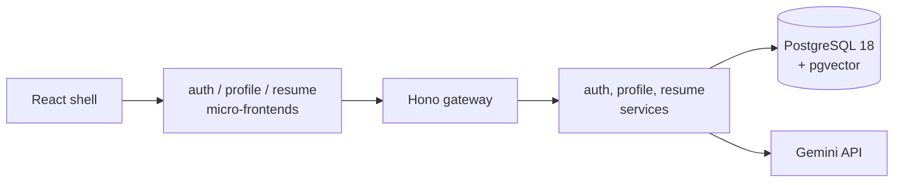

# ResumeForge

Upload or write a resume, edit it section by section, check it against a job description, and let Gemini tailor a copy for that job. You review every AI change before it is applied. The app itself is called Forge Studio.


## What it does

- **Imports resumes** from text-based PDF, DOCX, TXT and Markdown into an editable review screen.
- **Edits** with rich text, undo and redo, three templates, versions and PDF export.
- **Scores a resume** for general readiness and against a pasted job description, with specific feedback.
- **Tailors to a job (optional, Gemini).** Asks guided questions about your experience, keeps only facts you confirm, shows each change for approval, and saves the result as a separate copy with its own PDF.
- **Optional master profile** for your professional details.

Without a Gemini key, editing, local scoring and PDFs still work.

## Architecture



- **Frontend:** React 19, Vite, Module Federation, Tailwind CSS 4, Tiptap.
- **Backend:** Hono on Node.js, Zod, Google OAuth.
- **Data:** PostgreSQL 18 with Prisma 7. Resume embeddings (`gemini-embedding-001`, 768 dimensions) are stored in pgvector.
- **Repo:** pnpm workspaces and Turborepo. Each service runs with its own restricted database role.

## Run it

Needs Docker and a Google OAuth web client.

```sh
git clone https://github.com/nishank23/ResumeForge.git
cd ResumeForge
cp .env.example .env    # set GOOGLE_CLIENT_ID and GOOGLE_CLIENT_SECRET; Gemini is optional
docker compose up -d --build --wait --wait-timeout 180
```

Register `http://localhost:4001/api/v1/auth/google/callback` as the OAuth redirect URI, then open http://localhost:3000. Compose generates the database and service credentials itself.

Windows setup, native development without Docker, tests and teardown: [docs/setup.md](docs/setup.md). Other guides: [docs/](docs/README.md).
