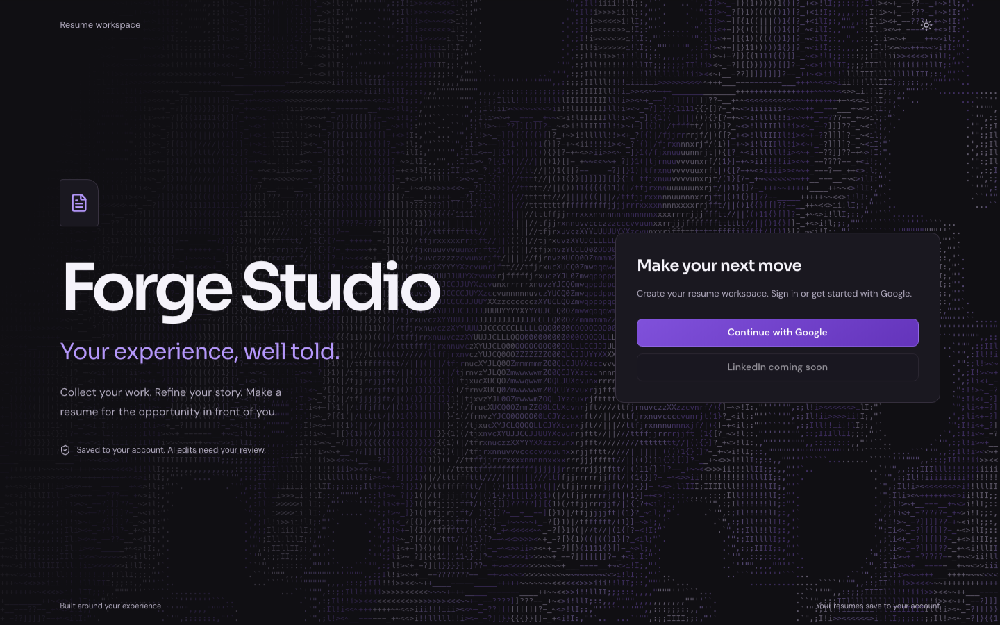
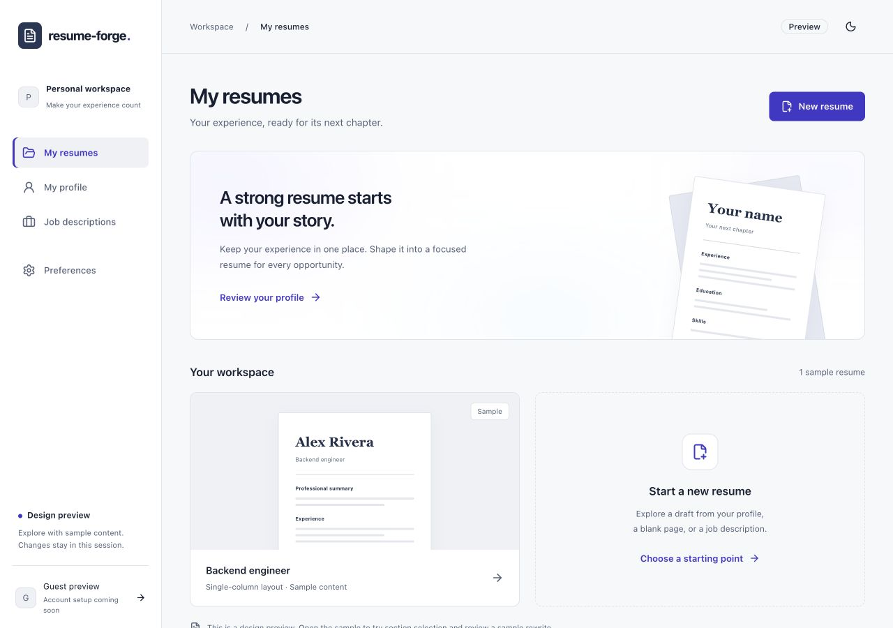
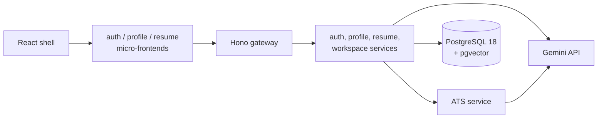

# ResumeForge

**Forge Studio** is a personal resume workspace. Import or write a resume, edit it section by section, check how well its PDF reads, score it against a job description, and let Gemini tailor a separate copy for that job. Every AI change is shown to you for approval before it is applied.

**Live:** [resumeforge.sugarbuddyai.com](https://resumeforge.sugarbuddyai.com/sign-in) (sign in with Google)



## Features

| Area | What you get |
| --- | --- |
| **Import** | Upload a text-based PDF, DOCX, TXT or Markdown resume. You review the extracted content before it is saved. |
| **Edit** | Rich-text editor with undo/redo, three templates, saved versions and PDF download. |
| **Readability** | Checks that the saved PDF's text can be extracted in the right order, and shows the exact text a parser sees. No AI involved. |
| **Job fit** | Paste a job description and get a score based on which requirements your resume supports, with quoted evidence. |
| **Tailoring** | Gemini asks guided questions about your experience, uses only facts you confirm, and proposes changes one by one. The result is saved as a separate copy with its own PDF. |
| **Profile** | Optional master profile for your professional details. Tailored resumes never change it silently. |

Without a Gemini key, importing, editing, readability, local scoring and PDF export still work. AI requests have per-user and site-wide daily limits; see [AI usage limits](docs/api-reference.md#ai-usage-limits--2026-11-21).



## Architecture



- **Frontend:** React 19, Vite, Module Federation, Tailwind CSS 4, Tiptap.
- **Backend:** Hono on Node.js 22+, Zod, Google OAuth.
- **AI:** `gemini-3.8-flash` for tailoring, `gemini-3.5-flash-lite` for small edits and job-fit evidence, `gemini-embedding-001` (768 dimensions) for retrieval.
- **Data:** PostgreSQL 18 with Prisma 7 and pgvector. Each service connects with its own restricted database role.
- **PDF:** Server-side rendering in an isolated worker pool; readability uses `pdfjs-dist` on the same saved PDF.
- **Repo:** pnpm workspaces and Turborepo.

## Repository layout

```text
apps/
  shell/          host app and routing
  auth-mfe/       sign-in
  profile-mfe/    master profile
  resume-mfe/     library, editor, readability, job fit, tailoring
services/
  gateway/        public API entry point
  auth-service/   Google OAuth and sessions
  profile-service/
  resume-service/ resumes, versions, PDF, readability, tailoring
  ats-service/    stateless job-fit assessment (no database access)
  workspace-service/ audit recipient and workspace access
packages/
  resume-core/    pure scoring and resume logic
  access-policy/  permission checks
  shared/, shared-types/, prisma-client/, audit-contracts/
docs/             technical guides
context/          architecture, data model and project context
```

## Run locally

You need Docker and a Google OAuth web client.

```sh
git clone https://github.com/nishank23/ResumeForge.git
cd ResumeForge
cp .env.example .env    # set GOOGLE_CLIENT_ID and GOOGLE_CLIENT_SECRET; Gemini is optional
docker compose up -d --build --wait --wait-timeout 180
```

Register `http://localhost:4001/api/v1/auth/google/callback` as the OAuth redirect URI, then open http://localhost:3000. Compose generates the database and service credentials itself.

To enable AI, also set `GEMINI_API_KEY` and `GEMINI_DATA_MODE=paid` (billed Gemini project only).

Windows setup, native development without Docker, and teardown: [docs/setup.md](docs/setup.md).

## Checks

```sh
pnpm install
pnpm check      # lint + typecheck
pnpm build
pnpm test
```

## Deployment

Pushes to `main` run lint, type checks, tests, image builds and an isolated integration suite in GitHub Actions, then deploy to a Google Compute Engine VM behind Cloudflare. See [CI/CD](docs/ci-cd.md) and [cloud deployment](docs/cloud-deployment.md).

## Documentation

- [Setup](docs/setup.md) and [Docker details](docs/docker-setup.md)
- [Technical guides index](docs/README.md): API, ATS/Gemini workflow, readability, tailoring
- [Project context](context/README.md): architecture, data model, authorization
- [Product plan](PLAN.md)
