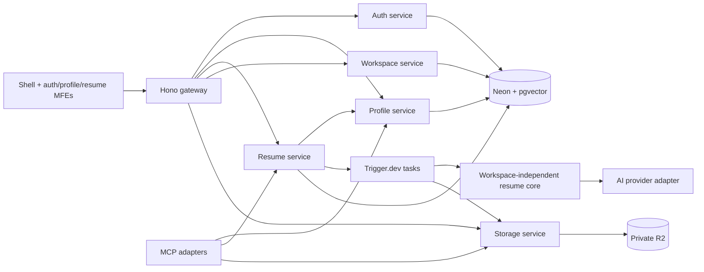

# Architecture Context

This is the target architecture, not deployed infrastructure. Stack choices come from the supplied plan plus the user’s 2026-09-29 Performative UI addition; implementation refinements remain subject to [decisions.md](decisions.md).

## Stack

| Layer | Planned technology | Responsibility |
|---|---|---|
| Workspace | pnpm + Turborepo | Package boundaries, dependency graph, shared tasks |
| Frontend | Vite 6 + React 19 + TypeScript | Browser-rendered shell and remote applications |
| Federation | `@module-federation/vite` | Independently buildable auth/profile/resume remotes |
| Navigation | React Router v7 | Shell-owned workspace routes |
| UI | Tailwind CSS v4 + shadcn/ui + Lucide + Performative UI | Shared tokens, accessible primitives, wrapped prompts/backgrounds/surfaces/accents; D13 compatibility gate |
| Forms | React Hook Form + Zod | Form state and boundary validation |
| State | Zustand + TanStack Query | Local interaction state and scoped server cache |
| Editing/preview | Tiptap + `@react-pdf/renderer` | Limited rich text and resume rendering |
| HTTP | Hono on Node.js containers | Gateway and domain service APIs |
| Identity | Google + LinkedIn OAuth; JWT sessions | Provider sign-in and application sessions |
| Database | Neon PostgreSQL + pgvector + Prisma 7 | Relations, structured JSONB, semantic vectors |
| Async work | Trigger.dev v4 | Durable AI, scoring, embedding, and PDF tasks |
| AI | Vercel AI SDK, Gemini default | Provider adapters and validated structured output |
| Artifacts | Cloudflare R2 | Private PDFs and temporary import uploads |
| Frontend hosting | Cloudflare Pages | Shell and remote static deployments |
| Integration | MCP SDK | Adapters over authorized application use cases |

Pin versions after checking compatibility in Phase 1. Node.js host and deployment topology remain D10. Hono portability does not imply Prisma, PDF, or background workers already run on Cloudflare Workers.

## System shape



## Service ownership

| Service / local port | Owns | Boundary |
|---|---|---|
| `gateway` / 4000 | Routing, edge authentication, CORS, limits, correlation IDs | No resume/profile business logic; does not expose `/internal/*` |
| `auth-service` / 4001 | User identity, OAuth accounts, sessions, JWT issuance | Does not own professional profile or tenant membership |
| `profile-service` / 4002 | UserProfile, UserContact, profile sections, reviewed imports | Returns scoped DTOs; authorizes contact separately |
| `resume-service` / 4003 | JDHistory, Resume, ResumeVersion, TaskRun, templates, pipeline | Fetches authorized profile snapshots; owns resume persistence |
| `storage-service` / 4004 | Object operations, bounded signed capabilities, cleanup | No user/tenant authority inferred from an R2 key |
| `workspace-service` / 4005 | Workspace identity, organizations, vendors, membership, policy context, AuditEvent | Owns membership and durable audit ingestion |

Services share a physical database initially, with logical table ownership. Shared Prisma access is not permission to mutate another service's domain tables. Use authenticated internal HTTP for cross-service use cases. Cross-service workflows use idempotency and reconciliation rather than pretending a distributed call is one SQL transaction.

Local Phase 1 uses opaque access credentials backed by auth-service's process-local map and revocable database sessions. A service-authenticated `/internal/auth/resolve` boundary now supplies minimal personal actor context through `@resume-forge/access-policy/server`; it does not share the session database with profile consumers or activate shared-workspace policy. Production JWT/distributed storage and hosting remain deferred. See [actor resolution](../docs/actor-resolution.md).

`/internal/` routes need service authentication as well as network isolation. Carry the verified actor and tenant context; workers must not impersonate a globally privileged user. Services enforce resource access even when the gateway already authenticated the request.

## Proposed repository layout after approval

```text
apps/
  shell/                    # Router, session bootstrap, workspace switcher
  auth-mfe/                 # Sign-in, OAuth return and session states
  profile-mfe/              # Wizard, profile editing, import review
  resume-mfe/               # Generation, preview, ATS, dashboard, history
services/
  gateway/ auth-service/ profile-service/
  resume-service/ workspace-service/ storage-service/
packages/
  shared/                   # @resume-forge/shared: UI, tokens, formatters
  shared-types/             # @resume-forge/shared-types: validated public contracts
  authorization/            # @resume-forge/authorization: permissions, policy, DTO privacy
  resume-core/              # @resume-forge/resume-core: domain engine
  ai-provider/              # @resume-forge/ai-provider: model/prompt/schema adapters
  prisma-client/            # @resume-forge/prisma-client: schema, migrations, DB helpers
trigger/                    # Proposed shared worker entrypoint + task definitions
tests/                      # Cross-service and end-to-end scenarios
```

The root worker directory is a proposed clarification to the source tree, which named tasks but omitted their home. No implementation directories are created during context preparation.

## Shared package boundaries

- `shared`: browser-safe UI and utilities, including Performative UI wrappers and token/style integration; no secrets, provider calls or database imports.
- `shared-types`: profile/contact DTOs, resume/version contracts, parsed JD, ATS, workspace, auth, audit schemas. Keep private persistence models out of public exports.
- `authorization`: pure policy plus server middleware/sanitizers in separate entrypoints. UI capability hints are never enforcement.
- `resume-core`: typed section-scoped suggestion contracts, JD parsing contracts, fact selection, content generation orchestration, ATS and gap logic, template registry and render contracts. Accept typed professional data and injected AI/render adapters. No actor, JWT, workspace, database client, R2 key, or service discovery.
- `ai-provider`: configured model/embedding adapters, prompt versions, Zod output schemas, timeout/retry budgets. Credentials remain on the server.
- `prisma-client`: client construction, models, migrations, parameterized vector queries. Only server services/workers import it.

## Microfrontend contract

The shell owns browser history, session lifecycle, active-workspace selection, and top-level error boundaries. Remotes expose documented route components. Share compatible React/React DOM instances; verify routing and context across production federation builds. A remote load failure displays recovery without taking down the shell.

Pass a narrow browser-safe shell context and API client contract. Never pass long-lived secrets or database models through federation props. Query keys include user, workspace type/ID, resource, filters, and visibility variant. Clear or invalidate cache on logout, membership changes, and workspace switch; abandon stale in-flight responses from the prior scope.

Workspace settings/member/audit screens are shell-owned in Phase 4 using shared components. A separate workspace MFE is not part of this plan.

## Resume lifecycle

1. Authenticate, authorize, resolve the profile and JD under the requested workspace.
2. Persist an idempotent run intent with actor, tenant, profile revision, JD, and template versions.
3. Trigger background work; persist external run ID and reconcile dispatch failures.
4. Worker rechecks current access, loads a scoped snapshot, and calls the workspace-independent engine.
5. Parse JD → map supported profile facts → generate schema-valid content → score against the JD.
6. Persist an immutable ResumeVersion, score/rubric metadata, and current-version pointer atomically within the resume domain.
7. Preview the approved DTO. Phase 3 adds private PDF rendering/upload and artifact metadata.
8. Emit durable audit events; expose only sanitized task progress to an authorized client.

Source resume statuses are `generating`, `completed`, and `failed`. Task stage/status and PDF readiness are separate: a completed content version need not already have a PDF. Proposed dispatch state, optimistic revisions, provenance, and artifact metadata are detailed in [data-model.md](data-model.md).

## Non-negotiable boundaries

Authorization applies before data fetches and again at serialization/export boundaries. Contact restrictions cover derived content, cached versions, PDFs, logs, task metadata, and MCP. Private contact must not enter ordinary AI prompts or public task outputs. A revoked membership cannot continue fetching resources merely because it once received a task ID.

Phase 1 establishes personal-workspace ownership and audit event capture contracts. Phase 4 activates organization/vendor access only after full RBAC, privacy, and audit verification. This prevents the roadmap from delaying essential isolation until after data is stored.

See [data model](data-model.md), [authorization](authorization-model.md), [API contracts](../docs/api-reference.md), and [deployment](../docs/deployment.md).

## Contextual editing extension — planning update

[Frontend integration](frontend-integration.md) defines dependency boundaries; [editing contract](resume-editing-contract.md) defines behavior. Reuse the existing resume MFE/service, shared package, AI adapter and task worker. Basic draft creation can omit JD/AI. Section suggestions are private proposal resources tied to a base version, stable target and optional JD; they do not change the current version until explicit Apply commits an authorized, conflict-checked new version. No new MFE/service or general chat infrastructure is required. Late results cannot modify a different selection, workspace or newer version.

## U06 expansion boundaries

[Capability coverage](resume-capability-coverage.md) expands F08 editing, F07 issue handling and F10 management. Proposed Phase 6 adds F19 staged file parsing in an isolated worker/private storage and F20 shared browser/server template settings. Resume service owns imports, versions, preferences and scoped preset use cases; profile service remains the sole master-profile writer. Core receives normalized, contact-free, user-confirmed facts with provenance and validated render settings. No new microfrontend, domain service, MCP tool or permission name is implied.
