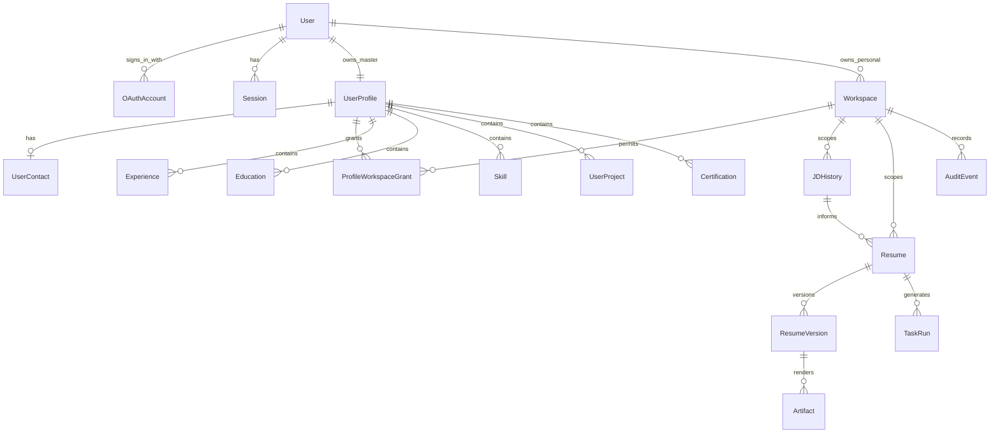

# Data Model

## Current audit snapshot — 2026-10-11

The schema includes identity/sessions, workspace/organization/vendor/membership/grants, profiles/contacts/sections, JDs, resumes/versions/tasks, audit/outbox and ResumeSearchChunk. Current resume vectors are gemini-embedding-001/768/professional-v1. Artifact/preset/fact-provenance/invitation-token/default-preference models remain proposed. Table presence does not activate legacy routes.

[Implementation audit](../docs/implementation-audit.md) provides completion checklists, source, gaps and priorities. Dated observations and original target designs below remain historical evidence or future acceptance.

## Readiness-v2 JSON compatibility — 2026-10-09

Private `Resume.atsBreakdown.readiness` history now accepts `readiness-v1` and `readiness-v2`. Checks may carry `scored: false` for additional advice and a header target for owner-only contact-presence guidance. Numeric components retain the approved weights/rules; advice never changes their totals. No table migration or role/grant change is required. Assessment identity binds immutable version, professional projection, derived contact-presence boolean and rubric. Raw contact values are absent from assessment JSON/core/AI; old snapshots remain untouched. [Workflow](../docs/ats-workflow.md#no-jd-rule-guidance-and-compatibility--2026-10-09).

## Current Gemini and compact assessment update — 2026-10-09

The user now selects paid **gemini-3.5-flash-lite** for semantic JD evidence and selected wording, superseding earlier Gemini-analysis-only/MiMo-rewrite instructions. Server keys, explicit per-request consent, professional/contact-free scope, grounding, immutable-version review/Apply and private gemini-embedding-001/768 retrieval remain. ATS groups all checks into five expandable areas; JD editor/breakdown/evidence collapse after evaluation. Approved numeric rubrics stay deterministic. OpenCode SDK/native/HTTP and unused Textkernel runtime/tests are removed; legacy stored proposals/public result schemas remain readable. [Current configuration, API behavior and limits](../docs/ats-workflow.md).

## Current private vector cache — 2026-10-09

ResumeSearchChunk now stores 768-dimensional gemini-embedding-001 entry embeddings with owner/workspace/resume/immutable version, stable target, projection/model/hash and generation metadata. RLS and exact scoped SQL restrict retrieval; save/delete invalidates derived cache without changing source history. Proposed profile/JD 1536 and Skill 384 spaces remain separate, unimplemented decisions. [Current contract](../docs/resume-vector-search.md).

## Local JD and rewrite metadata — 2026-10-09

Existing private Resume.atsBreakdown now has jdMatching evaluations/dismissed and rewrites proposal arrays alongside readiness. Each assessment/proposal binds an immutable ResumeVersion and input hash. Stored proposals include exact target, original/proposed fields, model, expiry basis and applied version; apply creates one immutable content version and audit atomically. Bound each array at 100 and combined serialized metadata at 2,000,000 characters; fail rather than silently erase history. No schema/grant/profile/contact change. [Exact contract and persistence limits](../docs/ats-workflow.md).

## Local general readiness metadata — 2026-10-09

The personal readiness slice uses the existing nullable `Resume.atsBreakdown` JSON under a `readiness` namespace: `{ evaluations: [...], dismissed: [...] }`. Evaluations are append-only application metadata with resume ID, immutable ResumeVersion ID/number, contact-free projection hash, time, mode/rubric, component weights/counts/score, generic checks and stable targets. Preferences are separate from immutable evaluations. Older assessments remain retained; the API exposes the latest and preceding record. Bounds are 100 evaluations and 2,000,000 serialized metadata characters; no eviction/purge is implemented.

Assessment writes do not alter immutable ResumeVersion content or advance Resume.currentVersion, and do not replace legacy JD atsScore. Resume.updatedAt can advance for assessment/preference metadata. A saved content version change makes prior evidence stale. There is no database migration, additional grant, shared-workspace read or master-profile/contact update. This is a bounded local extension; the full durable assessment/artifact model remains pending.

## Personal editor persistence — 2026-10-04

Current Prisma Resume/ResumeVersion records support the bounded personal editor. `content.editorDraft` contains validated rich text, stable IDs, dates, visibility, languages and appearance; the flat projection is retained for legacy adapters. Reviewed import source text is private version content. Saves use expected currentVersion, immutable history and an atomic audit outbox. Resume.profileId requires an empty internal UserProfile anchor if none exists; this does not import facts or contacts. No schema migration was added. Original upload bytes are not retained. Shared/export contact snapshots, provenance and full F19 storage remain proposed.

## Status and ownership

This is the logical schema specification. The schema includes identity, workspace, sections, resume/JD/task and audit/cache entities; proposed supporting models remain future scope. The original ERD remains in [source-plan.md](../docs/archive/2026-10-14/docs/source-plan.md). D03/D04/D07/D08/D11/D12 in [decisions.md](decisions.md) affect final migrations. Items marked **Proposed** extend the source to make security and lifecycle requirements explicit.

Use opaque stable IDs, UTC timestamps, explicit foreign keys, and server-derived ownership. Every tenant-owned object resolves to exactly one workspace. No child ID is sufficient authority to read or modify its parent resource.

## Source entity inventory

| Entity / owner                     | Fields to preserve from the source                                                                                                                                                                | Constraints and interpretation                                                                                                                                          |
| ---------------------------------- | ------------------------------------------------------------------------------------------------------------------------------------------------------------------------------------------------- | ----------------------------------------------------------------------------------------------------------------------------------------------------------------------- |
| User / auth                        | id, email, name, avatarUrl, provider, providerId, refreshToken, providerData, isOnboarded, createdAt, updatedAt                                                                                   | Do not store plaintext refreshToken or expose providerData. Proposed replacement relations below; authenticated account email is private identity data.                 |
| UserProfile / profile              | id, userId, fullName, location, professionalSummary, embedding, createdAt, updatedAt                                                                                                              | Source has unique userId; D03 must resolve shared master vs workspace copies before finalizing uniqueness.                                                              |
| UserContact / profile              | id, profileId, email, phone, address, linkedinUrl, githubUrl, portfolioUrl, updatedAt                                                                                                             | Unique profileId; separate storage/DTO access. Contact email is independent of login email.                                                                             |
| Education / profile                | id, profileId, institution, degree, fieldOfStudy, startDate, endDate, gpa, description, sortOrder                                                                                                 | Scoped through profile; validate dates/GPA without requiring GPA.                                                                                                       |
| Experience / profile               | id, profileId, company, title, location, startDate, endDate, isCurrent, bulletPoints, keywords, metrics, sortOrder                                                                                | No fabricated bullet metrics; current role has an explicit open end date.                                                                                               |
| Skill / profile                    | id, profileId, name, category, proficiency, embedding                                                                                                                                             | Categories: technical, soft, language, tool. Proficiency: beginner, intermediate, advanced, expert; handle absence rather than inventing it.                            |
| UserProject / profile              | id, profileId, name, description, url, technologies, startDate, endDate                                                                                                                           | Professional projects, not recruitment projects. URL is validated/sanitized.                                                                                            |
| Certification / profile            | id, profileId, name, issuer, issueDate, expiryDate, credentialUrl                                                                                                                                 | Expiry may be absent; credential must come from user facts.                                                                                                             |
| Organization / workspace           | id, name, slug, logoUrl, settings, createdAt, updatedAt                                                                                                                                           | Unique slug; proposed Workspace relation under D04.                                                                                                                     |
| Vendor / workspace                 | id, name, slug, logoUrl, settings, createdAt, updatedAt                                                                                                                                           | Unique slug; consent is not implied by creation.                                                                                                                        |
| OrganizationMembership / workspace | id, organizationId, userId, role, status, createdAt, updatedAt                                                                                                                                    | Unique organizationId+userId; roles must match organization type.                                                                                                       |
| VendorMembership / workspace       | id, vendorId, userId, role, status, createdAt, updatedAt                                                                                                                                          | Unique vendorId+userId; roles must match vendor type.                                                                                                                   |
| JDHistory / resume                 | id, profileId, workspaceType, workspaceId, createdByUserId, jobTitle, company, rawJD, parsedKeywords, parsedRequirements, parsedResponsibilities, experienceLevel, roleType, embedding, createdAt | Scoped to workspace and accessible profile; JD/company fields describe tailoring input, not a jobs table.                                                               |
| Resume / resume                    | id, profileId, ownerUserId, workspaceType, workspaceId, createdByUserId, jdHistoryId, templateId, content, atsBreakdown, atsScore, pdfR2Key, currentVersion, status, createdAt, updatedAt         | Current summary/pointers; never diverge from current immutable version. Proposed basic-builder mode makes JD and JD-specific score nullable; missing score is not zero. |
| ResumeVersion / resume             | id, resumeId, versionNumber, content, atsBreakdown, atsScore, pdfR2Key, createdByUserId, createdAt                                                                                                | Unique resumeId+versionNumber; immutable content snapshot. Artifacts may finish later via separate metadata.                                                            |
| AuditEvent / workspace             | id, actorUserId, workspaceType, workspaceId, targetUserId, action, resourceType, resourceId, metadata, timestamp                                                                                  | Append-only application access; metadata allowlist excludes raw sensitive data.                                                                                         |
| TaskRun / resume                   | id, runId, profileId, workspaceType, workspaceId, userId, createdAt                                                                                                                               | Unique external runId when assigned; ownership verified before task status/token access.                                                                                |

## Proposed supporting models and fields

| Model/change                                  | Reason and proposed shape                                                                                                                                                                | Decision         |
| --------------------------------------------- | ---------------------------------------------------------------------------------------------------------------------------------------------------------------------------------------- | ---------------- |
| Workspace                                     | id, type, personalOwnerUserId?, timestamps; one personal workspace per user; org/vendor row links to one workspace                                                                       | D04              |
| ProfileWorkspaceGrant or workspace-owned copy | Defines which profile is accessible in a workspace, its consent, allowed operations, grantedBy, and revokedAt; alternative copy model needs distinct profile ownership/version semantics | D03              |
| OAuthAccount                                  | userId, provider, providerSubject, minimal provider metadata; unique(provider, providerSubject)                                                                                          | D08              |
| Session                                       | userId, hashed refresh credential, expiry, revokedAt, rotation family/replay metadata; keep provider tokens encrypted only if actually required                                          | D08              |
| WorkspaceInvitation                           | workspace, intended role, minimal invite target, hashed token, inviter, expiry, acceptedAt/revokedAt; membership becomes active only under approved consent flow                         | D02              |
| Profile revision                              | revision counter and onboarding draft/completion fields; optimistic save and reproducible generation snapshots                                                                           | F03/F04 proposal |
| Version provenance                            | schemaVersion, source profile revision/fact IDs, JD revision, template version, model/prompt/rubric versions, content checksum                                                           | F06/F07 proposal |
| Protected resume header snapshot              | Contact snapshot separate from contact-free resume content, or an equally enforceable approved alternative; no unrestricted header inside public content JSON                            | D12              |
| Artifact metadata                             | Version ID, privacy variant, R2 key, checksum, content/template revision, status, createdAt; unique render identity prevents duplicate artifacts on retry                                | D12              |
| TaskRun lifecycle                             | resumeId?, kind, dispatch/status/stage, idempotency key, attempt/error code, input revisions, updatedAt; external runId nullable until dispatch completes                                | F06 proposal     |
| AuditOutbox                                   | Producer-local immutable event intent and delivery state; unique event ID used for idempotent ingestion into AuditEvent                                                                  | D11              |
| Template registry metadata                    | Stable templateId + version + renderer contract; static first template does not require a template table                                                                                 | F08 proposal     |

Proposed Workspace foreign keys replace unenforced polymorphic pairs where practical. Keep workspace type consistent with its parent, not freely supplied on writes. Final schema may retain type on audit/snapshot records for historical interpretation.

## Relationship sketch under the proposed Workspace model

D03 shared-master and D04 common Workspace were approved on 2026-09-30; this sketch also includes entities not yet implemented. Organization/vendor memberships retain their typed source relations unless D04 explicitly replaces them.

## JSONB contracts

| Column / contract            | Stored value                                                       | Validation                                                                                                          |
| ---------------------------- | ------------------------------------------------------------------ | ------------------------------------------------------------------------------------------------------------------- |
| Provider metadata            | Minimal provider identity metadata                                 | Allowlist; no raw tokens or unneeded profile dump                                                                   |
| Experience.bulletPoints      | `string[]` or versioned fact-bearing bullets after schema decision | Size limits; source facts retained                                                                                  |
| Experience.keywords          | `string[]`                                                         | Derived metadata; cannot become unsupported skills                                                                  |
| Experience.metrics           | `QuantifiedAchievement[]`                                          | Metric, value, direction, source evidence                                                                           |
| UserProject.technologies     | `string[]`                                                         | Bounded normalized list                                                                                             |
| JD parsed fields             | ExtractedKeyword[], Requirement[], responsibilities[]              | Schema version, evidence from JD, optional unknown fields                                                           |
| ResumeVersion.content        | StructuredResumeContent                                            | Stable section/item IDs, order, text, source references; scoped replacement validation; no unguarded contact fields |
| ATS breakdown                | Five component results                                             | Score, weight, reasons, input hash, rubric version                                                                  |
| Organization/Vendor.settings | OrgSettings / VendorSettings                                       | Explicit supported keys; no arbitrary policy override                                                               |
| AuditEvent.metadata          | Sanitized request/action context                                   | Allowlisted keys, request ID; no profile text or tokens                                                             |

## Vectors

Source dimensions: UserProfile 1536, JDHistory 1536, Skill 384. Treat these as requested targets awaiting D07 compatibility validation. Profile/JD similarity requires the same embedding model/version and dimensions. Skill comparisons use their own compatible embedding space; never compare a 384-dimensional vector directly with a 1536-dimensional vector.

Store model identifier, dimensions, source hash, and generatedAt alongside vectors. Recompute only changed content, invalidate stale results, and isolate semantic queries by tenant/profile authorization before returning matches. Embeddings are derived private data, not a public catalog.

## Constraints, deletion, and consistency

- Index scoped lists by workspace/time/ID, memberships by workspace/user, profile sections by profile/order, and audit events by workspace/time and actor/time. Validate actual query plans later.
- Prevent a resume linking to a JD/profile outside its authorized scope. A foreign key alone does not establish consent.
- Concurrent saves require an expected revision; return a conflict rather than overwrite a newer edit. Allocate version numbers transactionally.
- Atomic onboarding completion belongs to the profile domain; synchronize auth `isOnboarded` idempotently or derive it from profile state. Do not claim a cross-service HTTP exchange is atomic.
- Deletion removes access first, prevents workers recreating deleted output, then cleans version artifacts idempotently. Retention and audit pseudonymization require D11; do not blindly cascade away audit history.
- Account deletion, shared-profile revocation, and any retained workspace copies must follow the approved D03/D11 policy before release.

Verification belongs in [F03](../docs/archive/2026-10-14/context/feature-specs/03-database-schema.md) and [validation-strategy.md](validation-strategy.md).

## Implemented local audit delivery contract — 2026-10-02

AuditOutbox now stores attempts, nextAttemptAt, leaseToken/leaseExpiresAt, deliveredAt and an allowlisted lastErrorCode. Database checks constrain pending/delivering/delivered/blocked states, nonnegative attempts, active-lease fields and delivered timestamps. Claiming is atomic and bounded; acknowledgements update only the current lease token. Transient failures retry with persisted exponential delay (5 seconds to 5 minutes), while invalid/conflicting events remain blocked without payload edits or deletion. Expired claims can be recovered after a process failure.

Workspace-service owns personal ledger ingestion. AuditEvent.id is the producer eventId; normalized intent hashes detect conflicting reuse. New events preserve occurredAt as timestamp and include outcome/correlationId/payloadHash. These three fields remain nullable on legacy history rather than inventing missing facts. Ingestion does not reauthorize resource use or grant access: the producer must authorize the original action, and the implemented local HTTP adapter authenticates the producer. Local HTTP retry, automatic relay scheduling/shutdown/restart recovery and separate restricted capture/relay/ingestion roles are verified; normal local roles cannot alter audit history. Professional-profile GET/PUT and owned-workspace selector-denial capture/delivery are now verified; denial ingestion permits only the actor-owned workspace resource. Shared-workspace transport, hosted role/identity provisioning and retention remain open. See [runtime role boundaries](../docs/runtime-database-roles.md).

## Proposed builder and suggestion persistence

[Contextual editing](resume-editing-contract.md) adds a resume-service-owned ResumeSuggestion linked to workspace, resume, immutable base version, expected revision, stable target, optional JD/input revisions, validated proposal/provenance, status and applied-version ID. Extend TaskRun with a section-suggestion kind. Version provenance distinguishes profile-copy, manual save, full generation, suggestion apply and explicit restoration.

Unselected content and protected header references survive Apply unchanged. Apply atomically creates one version, advances its pointer, records suggestion linkage and local audit intent; duplicate Apply converges on the same result. A changed base version causes conflict. Resolve suggestion retention under D11 and privacy under D12 before persistence. Do not store a browser-selected JSON path as mutation authority. Basic drafts may have no JD or score; per-version JD provenance prevents retargeting from rewriting history.

## Proposed U06 models and version extensions

- Resume metadata: title and metadata revision. Clone records source resume/version provenance, new identity and independent initial version; never copies artifact URLs or active task state.
- ResumePreference: unique actor+workspace, nullable activeResumeId and revision. Validate target scope on every read/write and invalidate on deletion/revocation; a stored preference grants no access.
- ATSIssue: immutable evaluation/rule/version identity, target and evidence. Actor-scoped IssuePreference stores dismissal only; resolved state comes from later evaluation, not user manipulation of score evidence.
- ResumeImport (F19): creator/workspace/target profile, private upload relation, file type/size/checksum, parser/schema versions, bounded extraction, separated contact staging, review revision, lifecycle, expiry and resulting resume ID. States uploaded/queued/processing/review-ready/confirmed/failed/canceled/expired; terminal cancellation/expiry prevents publication. Confirm idempotently creates one resume; corrections and confirmation retain provenance.
- ResumeFact provenance: stable fact ID, origin profile/manual/import, confirmation revision and scoped source reference. AI-created text cannot become factual evidence without independent user confirmation. Import/local facts remain resume-local; no automatic master merge.
- ResumeVersion render identity (F20): template ID/version, settings schema version and validated typography/margins/spacing/colors/preset snapshot. Include render-settings hash with content, renderer/font version and privacy variant in artifact identity; changing settings invalidates old current-artifact claims.
- TemplatePreset (F20): owner actor or workspace, stable ID/version, typed settings only, visibility and archivedAt. Historical resume versions embed settings or retain immutable preset versions. No content/contact fields or executable code.

All relations enforce tenant/profile scope through their parent. No Phase 6 tables are required in initial migrations merely because they are planned. D14/D05/D11/D12 and feature acceptance govern their later implementation.

## Implemented saved-source tailoring metadata

`Resume.atsBreakdown.tailoring` holds bounded owned runs, source version/fingerprint, model/prompt version, stage progress, private draft/review, lease, stored validated operations, quality/warnings and idempotent copy linkage. `tailor-v2` uses Gemini 3.8 Flash and two or four stages; historical v1 defaults remain compatible. Unverified text is not a public proposal or new fact. New copies start at immutable version 1 and record source/model/prompt/selection provenance, with fresh local readiness/JD results. No new table/grant or master-profile write is required. [Detailed contract](../docs/full-resume-tailoring.md).

## Confirmed tailoring evidence — 2026-10-15

Tailor-v3 stores up to 30 confirmed professional answers (16,000 total characters) in each owned run's `additionalFacts`. Each answer binds a visible experience/project section and entry, question kind and explicit `confirmed: true`. Start validates target/privacy and fingerprints the complete provider fact bank with the immutable source version. Historical runs default to no additional facts. Independent copies retain only facts cited by selected proposals in `atsBreakdown.tailoringOrigin.confirmedFacts`. These are resume-local user assertions, not verified credentials or master-profile writes. No new table, migration or runtime grant is required.
