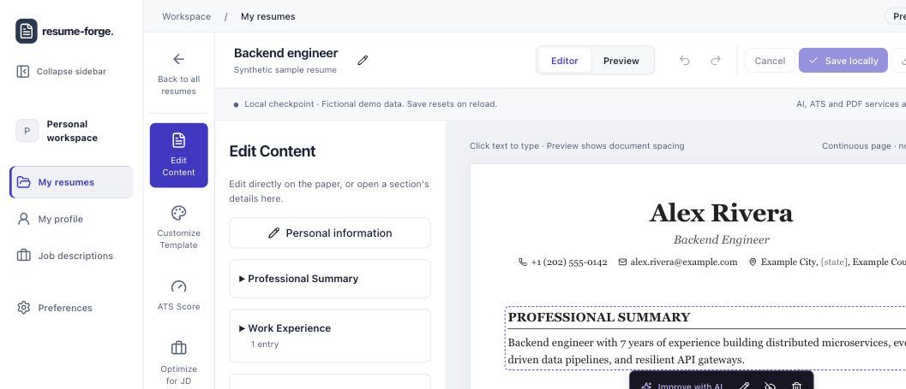
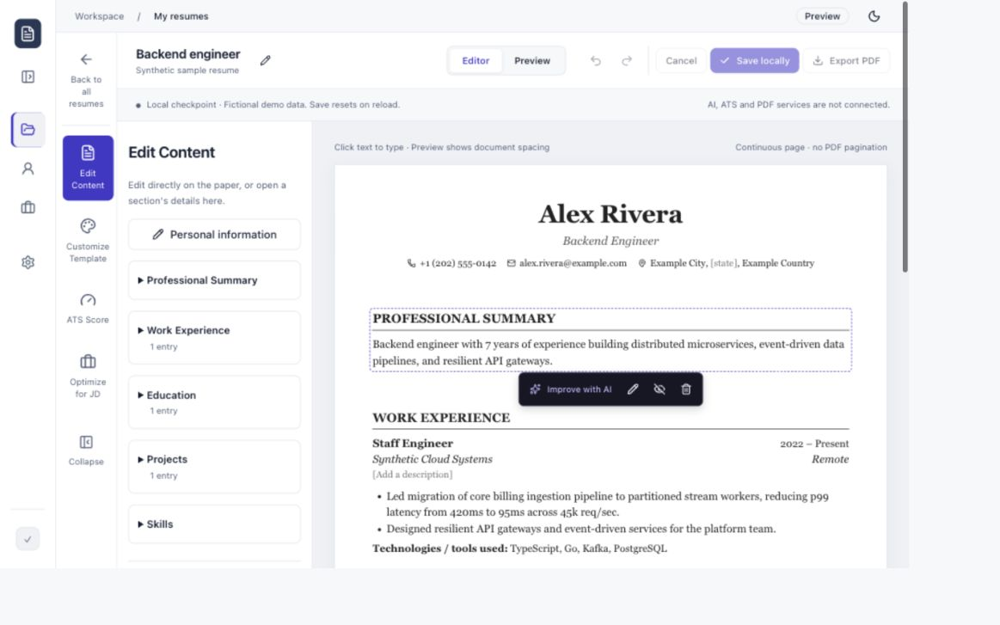

> Historical snapshot archived 2026-10-14. See [the current product plan](../../../../PLAN.md) and active documentation. This file is not current implementation authorization.

# Foldable workspace sidebar — 2026-10-04

## Historical evidence notice — 2026-10-11

This document retains the original plan or dated inspection/verification. It is not the current implementation register. Later resume persistence, PDF, readiness/JD scoring, paid Gemini, templates and UI changes supersede earlier pending/synthetic-only/provider/branch claims. Current status and remaining acceptance are in the [implementation audit](implementation-audit.md). Historical browser observations and test counts were not rerun for this documentation audit.

The first workspace column now folds independently of the resume editor's tool panel. This bounded shell change preserves the existing editor, routing, verified session and privacy boundaries.

## Delivered

- Collapse sidebar below the logo changes the desktop column to a 72px icon rail. Expand sidebar restores the original labeled column. In the editor, folding frees 112px; ordinary workspace pages gain 160px at the full desktop width.
- My resumes, My profile, Job descriptions and Preferences retain their icons, accessible names, native hover titles and active-route indication. Navigation targets are 44px square when folded. The brand and account link remain accessible.
- Collapse state stays while navigating within the mounted workspace shell and resets on reload. It uses no storage, server write or resume-history entry. Folding itself preserves the mounted editor draft and undo history; leaving the editor still clears its existing local draft.
- At 760px and below, the existing labeled mobile navigation menu remains in use. Short desktop windows scroll the sidebar so account navigation stays reachable.

## Actual checks

All commands below passed:

```sh
pnpm --filter @resume-forge/shared build
pnpm --filter @resume-forge/shell lint
pnpm --filter @resume-forge/shell typecheck
pnpm --filter @resume-forge/shell test
pnpm --filter @resume-forge/shell build
```

The shell suite passed **8/8 tests**, covering existing session, protected-route, callback and onboarding behavior. No implementation-mirroring unit tests were added for this reversible UI state. The existing federation dependency's browser externalization warning for `vm` remains non-fatal. Backend/database/provider suites were not rerun because this slice changes only shell presentation and shared CSS.

Source Prettier checks, `git diff --check` and four affected Markdown files (120 local links and balanced code fences) also passed.

Browser verification used the local signed-in sample workspace and clearly synthetic resume data. Dimensions below are measured CSS viewport sizes, accounting for existing browser zoom:

- At 1163×727, the editor sidebar changed from 184px to 72px and gave the workspace 112px more width. Enter/Space toggled Collapse/Expand and retained focus. All four folded links kept their names/titles, active My resumes state and 44px targets. No horizontal document overflow occurred. Light and dark chrome were inspected; the resume stayed white.
- A temporary synthetic headline edit and enabled Undo survived folding and reopening. Undo restored the original headline. A stylesheet rebuild had earlier reloaded the local preview; verification was repeated after that rebuild. This does not change the existing reset-on-reload boundary.
- At 900×500, the expanded sidebar had 674px of scrollable content within a 500px viewport. Keyboard focus scrolled the account link into view. Folded navigation also fit without horizontal overflow.
- At 390×844 and 320×740, the desktop collapse control was hidden. Enter/Space opened the labeled mobile menu. Selecting Preferences or Job descriptions closed it and opened the correct page. No horizontal document overflow occurred.
- Folded state stayed during workspace navigation, including the My profile route, then returning through My resumes to the sample editor. No profile/contact facts were edited. The temporary viewport override was reset and the sample editor left open.

Physical touch/virtual keyboard, IME and screen-reader speech remain separate manual checks. Durable resume saving, real AI, ATS and PDF limitations are unchanged.

## Manual checks

1. Open the running project at `http://localhost:3000`. Sign in and open the sample resume. If using an old tab, reload to load this change; existing local edits will clear.
2. Click Collapse sidebar below the logo. Confirm the first column becomes icons and the resume gets more space. Hover each icon to identify its destination; Expand sidebar restores labels.
3. Tab to the control and press Enter or Space. Confirm focus stays on it. Edit a synthetic resume field, fold/reopen and confirm the edit and Undo remain available.
4. Try all four workspace links. The rail should stay folded. Leaving the editor still discards its local draft, as stated in the UI. Reload should restore the expanded sidebar.
5. At 390px/320px, use Open navigation and select a labeled destination. At a short desktop height, Tab through links and confirm account access scrolls into view.

Next foundation slice remains owned Education list/add. No commit, push or deployment was performed.

Suggested commit: `feat: add collapsible workspace sidebar`

## Screenshots

The expanded capture is cropped above the account area. Both captures show synthetic resume content only.




