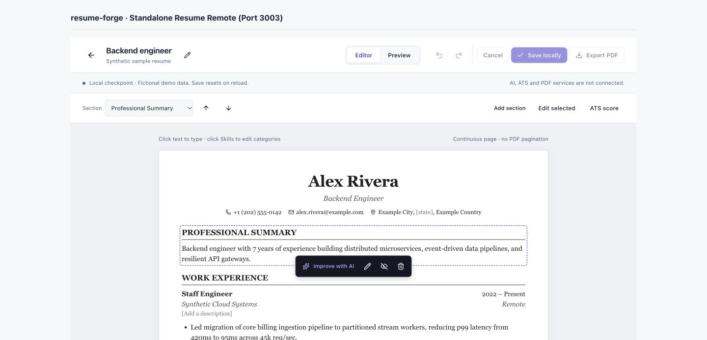
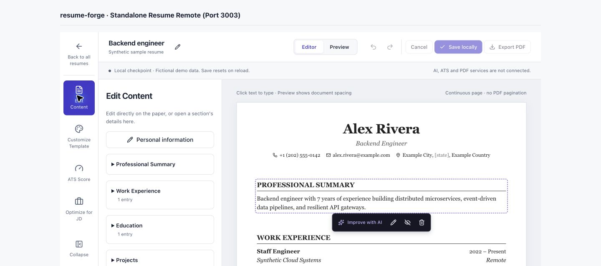
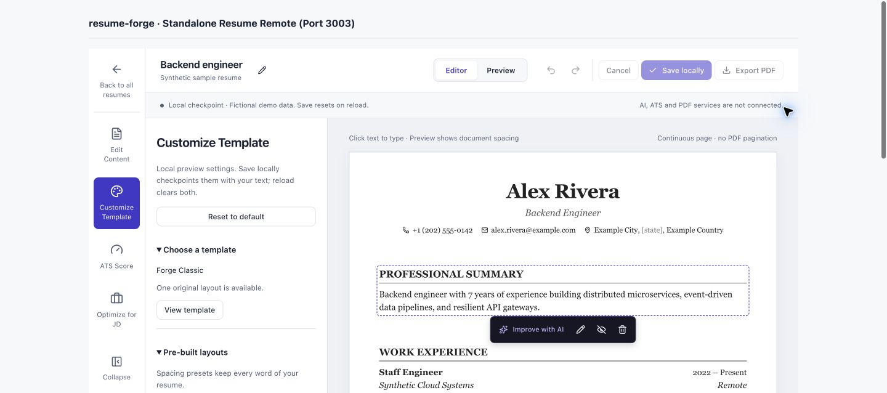
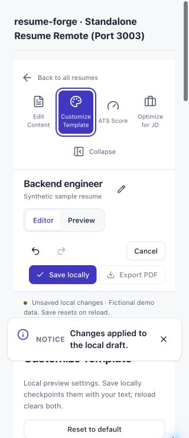

# Editor navigation and tool panels — 2026-10-04

Implemented one bounded local UI slice from the user's twelve reference screenshots, preserving the existing canvas/dialogs, separate synthetic contacts, authentication and scoped backend foundations. CareerZenith informed navigation and hierarchy only; no reference account data, URLs, template assets or screenshot binaries were copied into the repository.

## Delivered

- Back to all resumes at the top of a narrow left rail; Edit Content, Customize Template, ATS Score and Optimize for JD open a collapsible companion panel. Mobile uses horizontal tool buttons. Switching tools does not modify resume history; each new panel starts at its heading.
- Edit Content opens existing header/section/entry dialogs and supports entry addition, guarded section ordering, reversible visibility, confirmed deletion and missing sections. Direct paper editing, Summary Tiptap and grouped Skills/Languages remain intact. Preview disables content shortcuts while leaving navigation available.
- Customize Template provides one original Forge Classic preview, compact/balanced/spacious spacing presets, readable bounded margins/gaps and four typography roles (font, size, line height, dark color). Only installed system-font stacks are used; no font download or executable/custom CSS. Appearance joins the same local Save/Cancel and capped Undo/Redo history as text. Resetting equal settings creates no dirty/history change. Facts and contacts remain unchanged.
- ATS Score shows Not evaluated and Pending/Completed/Deleted status filters with honest unavailable explanations; no scores, counts, fake issues or issue mutations. Optimize for JD has a bounded local text composer and disabled analysis. Its native typing undo is independent of resume history; input clears when switching tools/leaving and is never sent or saved.
- Back uses the shell-owned current workspace route and warns before losing all local checkpoints. Standalone preview explains that the resume list belongs to the signed-in shell. Desktop Editor reserves a stable 52px footer gutter so contextual controls never cover the next heading; Preview renders the chosen section gap. Hover/focus do not reflow the paper. Mobile retains the existing fixed action dock.

## Actual checks

`pnpm --filter @resume-forge/resume-mfe build`, `lint`, `typecheck` and `test` pass; **20/20 tests**. Three new meaningful cases cover format-only fact/contact preservation plus checkpoint/history restoration, unsafe/unreadable/nonfinite values failing without mutation, and isolated presets/allowlisted projection. Existing 17 cases remain passing. Source formatting, changed Markdown links/fences and `git diff --check` pass. No dependencies or service/schema/auth/privacy/runtime configuration changed; backend/DB/provider suites were not rerun for this UI-only slice.

Browser checks used agent-created local tabs and synthetic content:

- Desktop 1440×638: all four tools, collapse/reopen, Enter/Space switching, section dialog Save/global Undo, one-template modal Escape/focus return, font/color computation, Compact/Undo/Redo/Save/Spacious/Cancel, no-op reset, ATS filter changes and disabled JD/PDF. JD native Cmd-Z retained the changed resume formatting. Switching tools preserves resume content and restores panel scroll to its heading.
- The signed-in shell's existing sample-workspace route opened the editor; Back showed the local-loss dialog, Stay restored focus to Back, and explicit Leave returned to My resumes. No account or profile facts were edited.
- Desktop Project action bar was below its section and ended before the next heading (4px clearance) at Compact density. Editor's gutter stayed 52px; Preview used the selected 12px gap and had zero editable nodes/actions. Summary and direct project title editing remained synchronized.
- Viewport overrides actually applied at 390×844 and 320×740. Horizontal tool switcher, panel collapse/activation and paper had no horizontal document overflow. Skills opened with Enter/Space; dialog widths were 358px/288px without internal horizontal overflow. At 390px a language tag saved through the grouped dialog; at 320px Cancel remained usable. This resolves the earlier Skills responsive-verification limitation, without claiming physical-device coverage.
- A long synthetic Summary at 320px produced a roughly 2988px continuous paper, retained all content, had no horizontal overflow, and Preview had no editable nodes. Reload restored the original synthetic content/default 14px body size. Browser warning/error log was empty at the checked final state.

Early compiler/lint issues were fixed (safe string indexing, unnecessary assertion/typed guard). Visual review found the footer toolbar overlap at compact spacing and panel scroll retention after switching; both were corrected before completion.

Actual touch/virtual keyboard, IME, screen-reader speech, provider/scoring accuracy, real private contacts, database resume reload and PDF extraction/render parity are not verified by these checks.

## Manual checks

1. Run `pnpm dev`; open `http://localhost:3000`, sign in and open the sample resume from My resumes. Refresh existing tabs to load the rebuilt MFE; this clears old local drafts.
2. Open each rail tool, collapse/reopen the panel and use Tab plus Enter/Space. Edit a Project through Edit Content, Save, Undo; confirm the paper and dialog agree. Click Skills and verify Languages stays in the same dialog without an AI action bar.
3. In Customize Template, try each spacing preset and typography/margins. Switch Preview to see actual document spacing. Save locally, change settings and Cancel; confirm the checkpoint returns. Reset default and Undo; confirm text and contacts stay intact.
4. ATS must say Not evaluated in every filter. JD input must not run analysis or claim saving. Export PDF remains disabled. Back must explain local loss; Stay keeps the draft and Leave returns to the list.
5. At 390px/320px, collapse the tool panel to read the paper, reopen tools and scroll the Skills dialog. Test on an actual phone/virtual keyboard as a separate check.

## Remaining work

The editor is synthetic and in-memory. All text/formatting checkpoints clear on reload/navigation/session loss. Real blank/profile creation, protected contact/header access, durable versions/conflicts and render settings remain E06/D12. Real AI/provider/grounding (E07), ATS rubric/evaluations/issue lifecycle (E08/D09), PDF/private artifacts/pagination (E09) and full F20 gallery/fit-to-page/shared presets stay pending. The next unblocked foundation slice remains owned Education list/add; no Education backend work was begun here.

Suggested commit: `feat: add resume editor navigation and tool panels`

## Screenshots

Only synthetic local preview content appears in these native browser captures.

