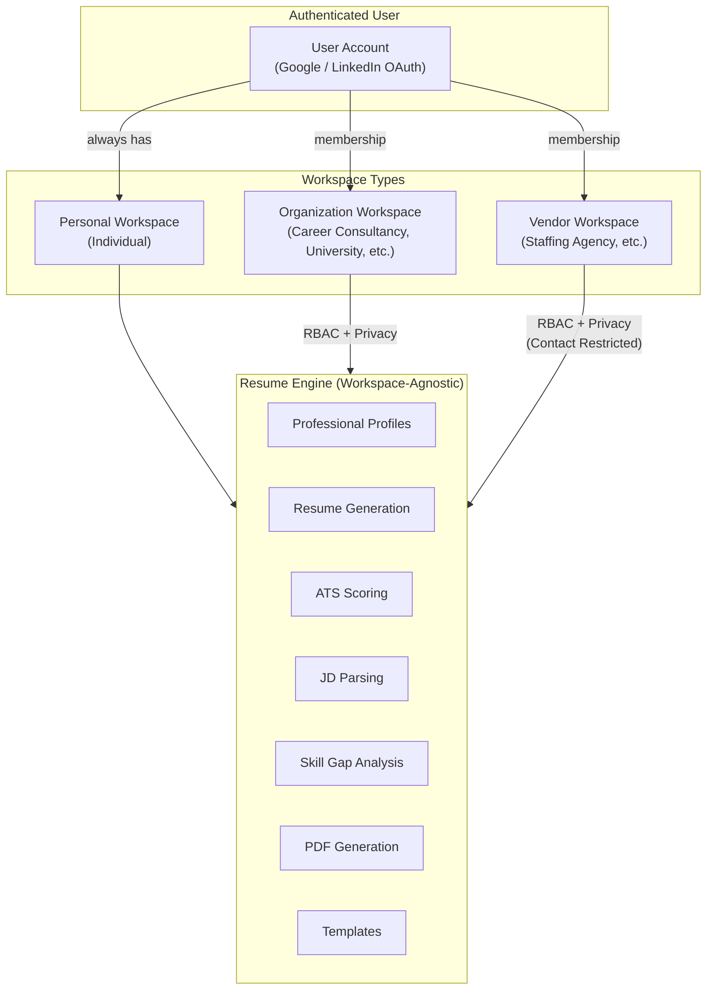
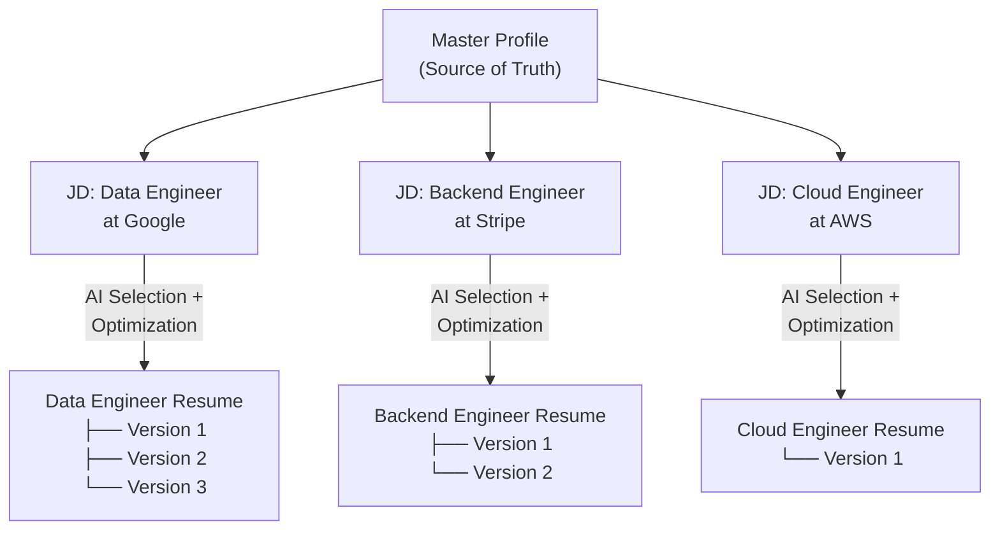
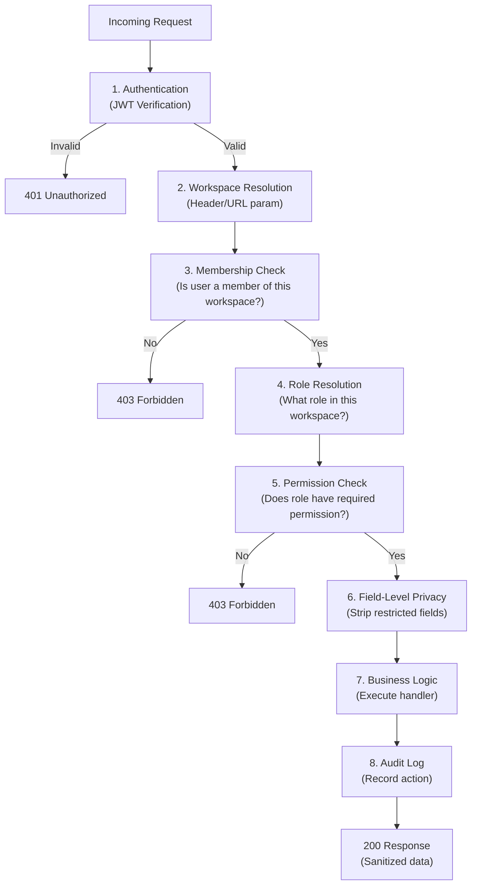
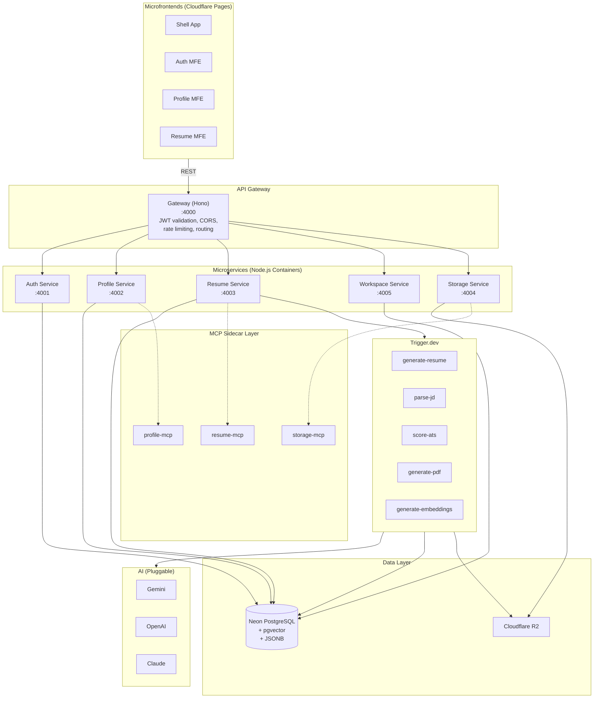
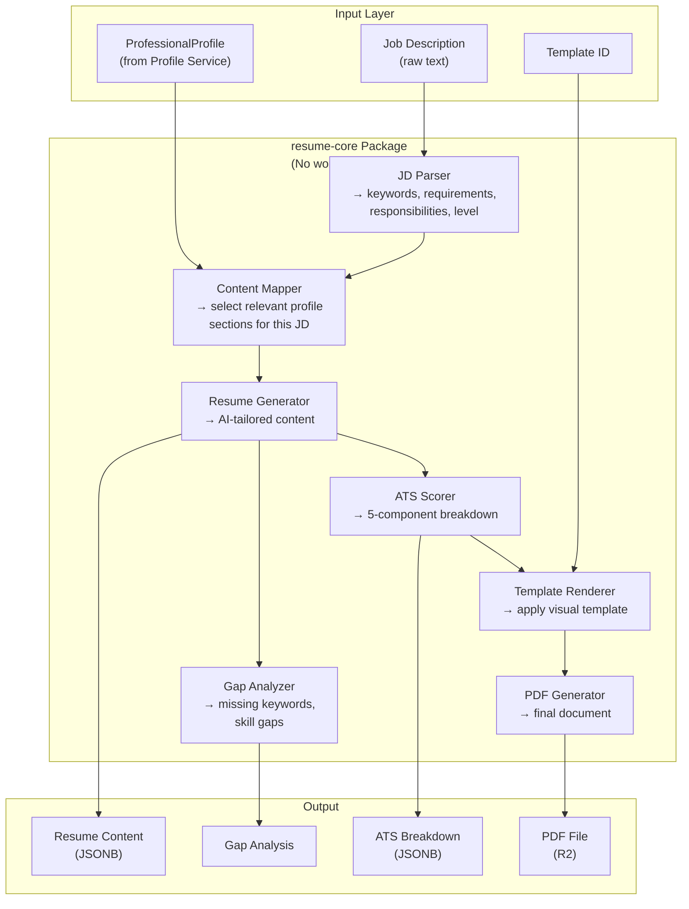

# resume-forge — Final Implementation Plan

## Historical evidence notice — 2026-10-11

This document retains the original plan or dated inspection/verification. It is not the current implementation register. Later resume persistence, PDF, readiness/JD scoring, paid Gemini, templates and UI changes supersede earlier pending/synthetic-only/provider/branch claims. Current status and remaining acceptance are in the [implementation audit](implementation-audit.md). Historical browser observations and test counts were not rerun for this documentation audit.

> Working copy of the supplied plan. The folder layout is normalized to the standalone `resume-forge/` root. Current feature numbering and decision status are documented in [the context index](../context/README.md) and [decisions](../context/decisions.md). Build steps below describe future work after context approval.

## Amendment — 2026-09-29 user request

Add Performative UI alongside Tailwind/shadcn/ui, with PromptHero entry points and contextual Prompt compositions for selected resume sections/items. Use CareerZenith as a resume-capability reference while retaining our own design and excluding its non-resume surfaces. Pause visual concepts; development remains unauthorized.

Same-day clarification: Performative UI may also provide backgrounds, surfaces and other suitable UI components alongside shadcn/ui. Proposed choices include Aurora, GlassCard and GradientText; use the current integration document for optional effects and accessibility/performance boundaries. A user-authorized signed-in Chrome review now supplements the public reference research; its observations do not imply cloning the interface or adopting every available feature.

The current [frontend integration](../context/frontend-integration.md) and [editing contract](../context/resume-editing-contract.md) expand F01/F06/F08: proposed basic profile-derived creation without a mandatory JD, explicit section requests, grounded proposals, readable comparison, Apply/Discard and immutable version saves. Later phases carry these semantics into management, export, privacy, audit and gaps. This amendment is a later planning change, not part of the originally supplied text. The later U06 request adds proposed F19 file intake (D14) and F20 template/format customization in Phase 6. The original five-phase, 18-feature source text below remains historical baseline; the current [roadmap](../context/build-plan.md) and [coverage register](../context/resume-capability-coverage.md) supersede its allocation for these additions.

## Goal

Build an enterprise-grade, multi-tenant AI Resume Builder as a **Microservice + Microfrontend** platform. Three workspace types — **Individual**, **Organization**, **Vendor** — share a common resume engine with workspace-aware RBAC, privacy controls, and audit logging. The system generates JD-tailored, ATS-optimized resumes and exposes reusable APIs + MCP interfaces so a future HR Recruitment Platform can integrate without coupling.

> [!IMPORTANT]
> **Product Boundary**: This is a **Resume/Profile Management** platform. It must NOT become an HR Recruitment Platform. No jobs, candidates, applicant tracking, interview scheduling, offers, or hiring workflows.

---

## Confirmed Decisions

| Decision | Choice |
|---|---|
| Monorepo | Turborepo + pnpm workspaces |
| Database | Neon Serverless PostgreSQL + pgvector |
| Cover Letter | Post-MVP feature (architecture supports it) |
| Backend Runtime | Node.js containers (Hono — Cloudflare Workers–ready) |
| Frontend Hosting | Cloudflare Pages |
| Storage | Cloudflare R2 |
| Background Processing | Trigger.dev |
| AI Provider | Pluggable via Vercel AI SDK (Gemini default) |
| Auth | Google + LinkedIn OAuth 2.0 (no Clerk) |

---

## Open Questions

> [!WARNING]
> 1. **Workspace Billing**: Should Organizations/Vendors have seat-based billing in a future phase, or is that completely out of scope?
> 2. **User Consent for Vendor Access**: When a vendor adds a user, does the user receive an invitation they must accept, or is it admin-assigned?
> 3. **Cross-Workspace Profile Sharing**: Can a user's master profile be shared across multiple workspaces, or does each workspace maintain its own copy?

---

## 1. Tech Stack (Final)

### Frontend
| Layer | Technology | Role |
|---|---|---|
| Build | Vite 6 | Fast HMR, ES module bundling |
| Framework | React 19 + TypeScript | UI rendering |
| Microfrontend | `@module-federation/vite` | Module Federation 2.0 |
| Routing | React Router v7 | Client-side routing |
| Styling | Tailwind CSS v4 + shadcn/ui + Performative UI | Shared primitives plus wrapped prompt compositions; later addition, D13 validation pending |
| Forms | React Hook Form + Zod | Validation |
| State | Zustand (client) + TanStack Query (server) | State management |
| Rich Text | Tiptap (minimal) | Bullet point editing |
| PDF Preview | `@react-pdf/renderer` | Client-side PDF |
| Icons | Lucide React | Icon system |

### Backend
| Layer | Technology | Role |
|---|---|---|
| HTTP Framework | Hono.js | Runtime-agnostic microservices |
| Auth | Custom OAuth 2.0 + JWT | Google + LinkedIn |
| Database | Neon PostgreSQL + pgvector + Prisma 7 | Relational + vectors + JSONB |
| AI | Vercel AI SDK (pluggable) | Provider abstraction |
| Background | Trigger.dev v4 | Durable workflows |
| Storage | Cloudflare R2 (S3-compatible) | Object storage |
| MCP | `@modelcontextprotocol/sdk` | Service reusability |
| Authorization | Custom RBAC + field-level privacy | Workspace-aware permissions |
| Audit | Application-level append-only log | Compliance + traceability |

---

## 2. Multi-Tenant Architecture

### 2.1 Workspace Model



### 2.2 User ↔ Workspace Relationships

```
User
 │
 ├── Personal Workspace (always exists, role: USER)
 │
 ├── Organization Memberships
 │   ├── "ABC Resume Consulting" → role: ORG_ADMIN
 │   └── "XYZ University Careers" → role: ORG_EDITOR
 │
 └── Vendor Memberships
     └── "Staffing Corp" → role: VENDOR_MANAGER
```

A user can switch between workspaces. The active workspace determines what data they can see and what actions they can perform.

### 2.3 Master Profile vs Resume (Separation)



> [!IMPORTANT]
> The AI selects and tailors content **from** the master profile **for** each JD. It never modifies the master profile itself.

---

## 3. RBAC & Privacy System

### 3.1 Roles

| Workspace Type | Roles |
|---|---|
| **Individual** | `USER` |
| **Organization** | `ORG_OWNER`, `ORG_ADMIN`, `ORG_MANAGER`, `ORG_EDITOR`, `ORG_VIEWER` |
| **Vendor** | `VENDOR_OWNER`, `VENDOR_ADMIN`, `VENDOR_MANAGER`, `VENDOR_EDITOR`, `VENDOR_VIEWER` |

### 3.2 Granular Permissions (27)

```typescript
// packages/authorization/src/permissions.ts
export const PERMISSIONS = {
  // Profile
  'profile.read':           'View professional profile',
  'profile.create':         'Create new profile',
  'profile.update':         'Edit profile sections',
  'profile.delete':         'Delete profile',
  'profile.contact.read':   'View private contact info (email, phone, address)',
  'profile.contact.update': 'Edit contact info',

  // Resume
  'resume.read':            'View resumes',
  'resume.create':          'Create new resume',
  'resume.update':          'Edit resume content',
  'resume.delete':          'Delete resume',
  'resume.generate':        'Trigger AI generation',
  'resume.download':        'Download PDF',

  // ATS & Analysis
  'ats.run':                'Run ATS analysis',
  'ats.view':               'View ATS scores',
  'skillgap.analyze':       'Run keyword gap analysis',

  // Cover Letter (post-MVP)
  'coverletter.generate':   'Generate cover letter',
  'coverletter.read':       'View cover letters',

  // Workspace Management
  'user.invite':            'Invite users to workspace',
  'user.manage':            'Manage workspace users',
  'user.remove':            'Remove users from workspace',
  'workspace.members.view': 'View workspace members',
  'workspace.members.manage': 'Manage memberships and roles',
  'workspace.settings.view': 'View workspace settings',
  'workspace.settings.manage': 'Manage workspace settings',

  // Templates
  'template.manage':        'Create/edit workspace templates',
  'template.view':          'View available templates',

  // Audit
  'audit.view':             'View audit logs',
} as const;
```

### 3.3 Role → Permission Mapping (Examples)

| Permission | `USER` | `ORG_OWNER` | `ORG_ADMIN` | `ORG_EDITOR` | `ORG_VIEWER` | `VENDOR_EDITOR` | `VENDOR_VIEWER` |
|---|---|---|---|---|---|---|---|
| `profile.read` | ✅ (own) | ✅ | ✅ | ✅ | ✅ | ✅ | ✅ |
| `profile.update` | ✅ (own) | ✅ | ✅ | ✅ | ❌ | ✅ | ❌ |
| **`profile.contact.read`** | ✅ (own) | ✅ | ✅ | ❌ | ❌ | **❌** | **❌** |
| `resume.generate` | ✅ | ✅ | ✅ | ✅ | ❌ | ✅ | ❌ |
| `resume.download` | ✅ | ✅ | ✅ | ✅ | ✅ | ✅ | ✅ |
| `workspace.members.manage` | ❌ | ✅ | ✅ | ❌ | ❌ | ❌ | ❌ |
| `audit.view` | ❌ | ✅ | ✅ | ❌ | ❌ | ❌ | ❌ |

### 3.4 Permission Evaluation Flow



### 3.5 Backend Privacy Enforcement

```
❌ WRONG: API returns all data → frontend hides fields
✅ RIGHT: Backend checks permissions → returns only permitted fields
```

```typescript
// packages/authorization/src/can.ts
interface AuthzContext {
  actor: { userId: string };
  workspace: { id: string; type: 'individual' | 'organization' | 'vendor' };
  action: Permission;
  resource?: { ownerId?: string };
}

export function can(ctx: AuthzContext): boolean { /* ... */ }

// In profile-service route handler:
const profile = await getProfile(targetUserId);
const contact = await getContact(targetUserId);

const response: any = { profile };

// Only attach contact if actor has permission
if (can({ actor, workspace, action: 'profile.contact.read' })) {
  response.contact = contact;
}
// Vendor editors will NEVER see contact data
return response;
```

---

## 4. Database Schema (Full ERD)

### 4.1 Entity Relationship Diagram

```mermaid
erDiagram
    User ||--|| UserProfile : has
    User ||--|| UserContact : has
    User ||--o{ OrganizationMembership : joins
    User ||--o{ VendorMembership : joins

    UserProfile ||--o{ Education : has
    UserProfile ||--o{ Experience : has
    UserProfile ||--o{ Skill : has
    UserProfile ||--o{ UserProject : has
    UserProfile ||--o{ Certification : has
    UserProfile ||--o{ Resume : generates
    UserProfile ||--o{ JDHistory : submits

    Organization ||--o{ OrganizationMembership : contains
    Vendor ||--o{ VendorMembership : contains

    Resume }o--|| JDHistory : tailored_for
    Resume ||--o{ ResumeVersion : versions

    User {
        string id PK "cuid()"
        string email UK
        string name
        string avatarUrl
        string provider "google | linkedin"
        string providerId UK
        string refreshToken
        jsonb providerData "Raw OAuth payload"
        boolean isOnboarded "false"
        datetime createdAt
        datetime updatedAt
    }

    UserProfile {
        string id PK "cuid()"
        string userId FK_UK
        string fullName
        string location
        text professionalSummary
        vector embedding "pgvector 1536 — semantic profile"
        datetime createdAt
        datetime updatedAt
    }

    UserContact {
        string id PK "cuid()"
        string profileId FK_UK
        string email
        string phone
        string address
        string linkedinUrl
        string githubUrl
        string portfolioUrl
        datetime updatedAt
    }

    Education {
        string id PK
        string profileId FK
        string institution
        string degree
        string fieldOfStudy
        string startDate
        string endDate
        float gpa
        string description
        int sortOrder
    }

    Experience {
        string id PK
        string profileId FK
        string company
        string title
        string location
        string startDate
        string endDate
        boolean isCurrent
        jsonb bulletPoints "string[]"
        jsonb keywords "string[] — AI-extracted"
        jsonb metrics "QuantifiedAchievement[]"
        int sortOrder
    }

    Skill {
        string id PK
        string profileId FK
        string name
        string category "technical | soft | language | tool"
        string proficiency "beginner | intermediate | advanced | expert"
        vector embedding "pgvector 384"
    }

    UserProject {
        string id PK
        string profileId FK
        string name
        string description
        string url
        jsonb technologies "string[]"
        string startDate
        string endDate
    }

    Certification {
        string id PK
        string profileId FK
        string name
        string issuer
        string issueDate
        string expiryDate
        string credentialUrl
    }

    Organization {
        string id PK
        string name
        string slug UK
        string logoUrl
        jsonb settings "OrgSettings"
        datetime createdAt
        datetime updatedAt
    }

    OrganizationMembership {
        string id PK
        string organizationId FK
        string userId FK
        string role "ORG_OWNER etc"
        string status "active | invited | suspended"
        datetime createdAt
        datetime updatedAt
    }

    Vendor {
        string id PK
        string name
        string slug UK
        string logoUrl
        jsonb settings "VendorSettings"
        datetime createdAt
        datetime updatedAt
    }

    VendorMembership {
        string id PK
        string vendorId FK
        string userId FK
        string role "VENDOR_OWNER etc"
        string status "active | invited | suspended"
        datetime createdAt
        datetime updatedAt
    }

    JDHistory {
        string id PK
        string profileId FK
        string workspaceType "individual | organization | vendor"
        string workspaceId
        string createdByUserId FK
        string jobTitle
        string company
        text rawJD
        jsonb parsedKeywords "ExtractedKeyword[]"
        jsonb parsedRequirements "Requirement[]"
        jsonb parsedResponsibilities "string[]"
        string experienceLevel
        string roleType
        vector embedding "pgvector 1536"
        datetime createdAt
    }

    Resume {
        string id PK
        string profileId FK
        string ownerUserId FK
        string workspaceType
        string workspaceId
        string createdByUserId FK
        string jdHistoryId FK
        string templateId
        jsonb content "StructuredResumeContent"
        jsonb atsBreakdown "ATSScoreBreakdown"
        float atsScore
        string pdfR2Key
        int currentVersion
        string status "generating | completed | failed"
        datetime createdAt
        datetime updatedAt
    }

    ResumeVersion {
        string id PK
        string resumeId FK
        int versionNumber
        jsonb content "StructuredResumeContent"
        jsonb atsBreakdown "ATSScoreBreakdown"
        float atsScore
        string pdfR2Key
        string createdByUserId FK
        datetime createdAt
    }

    AuditEvent {
        string id PK "cuid()"
        string actorUserId FK
        string workspaceType
        string workspaceId
        string targetUserId
        string action "profile.read etc"
        string resourceType "profile | resume | etc"
        string resourceId
        jsonb metadata "Request context"
        datetime timestamp
    }

    TaskRun {
        string id PK
        string runId UK
        string profileId
        string workspaceType
        string workspaceId
        string userId
        datetime createdAt
    }
```

### 4.2 JSONB Column Usage Map

| Model | Column | Type Stored | Example |
|---|---|---|---|
| `User` | `providerData` | Raw OAuth JSON | `{sub, name, picture, locale, ...}` |
| `Experience` | `bulletPoints` | `string[]` | `["Led team of 8...", "Reduced latency by 40%..."]` |
| `Experience` | `keywords` | `string[]` | `["kubernetes", "microservices", "golang"]` |
| `Experience` | `metrics` | `QuantifiedAchievement[]` | `[{metric: "latency", value: "40%", direction: "reduced"}]` |
| `UserProject` | `technologies` | `string[]` | `["React", "Node.js", "PostgreSQL"]` |
| `JDHistory` | `parsedKeywords` | `ExtractedKeyword[]` | `[{keyword: "Python", category: "technical", required: true}]` |
| `JDHistory` | `parsedRequirements` | `Requirement[]` | `[{text: "5+ years...", type: "experience"}]` |
| `JDHistory` | `parsedResponsibilities` | `string[]` | `["Design and implement...", ...]` |
| `Resume` | `content` | `StructuredResumeContent` | Full resume sections, text, ordering |
| `Resume` | `atsBreakdown` | `ATSScoreBreakdown` | 5-component score with details |
| `Organization` | `settings` | `OrgSettings` | `{defaultTemplateId, features, branding}` |
| `AuditEvent` | `metadata` | Request context | `{ip, userAgent, correlationId}` |

### 4.3 pgvector Column Usage Map

| Model | Column | Dimensions | What's Embedded | Used For |
|---|---|---|---|---|
| `UserProfile` | `embedding` | 1536 | Full profile text (summary + experience + education) | ATS relevance scoring |
| `Skill` | `embedding` | 384 | Individual skill name + context | Skill-to-JD matching |
| `JDHistory` | `embedding` | 1536 | Full JD text | Cosine similarity with profile |

---

## 5. Service Architecture

### 5.1 System Diagram



### 5.2 Service Responsibilities

| Service | Port | Owns | Does NOT Own |
|---|---|---|---|
| **Gateway** | 4000 | Routing, JWT validation, rate limiting, CORS | Business logic |
| **Auth** | 4001 | OAuth flows, JWT issuance, refresh tokens, User table | Profiles, workspaces |
| **Profile** | 4002 | UserProfile, UserContact, Education, Experience, Skill, UserProject, Certification | Resumes, auth |
| **Resume** | 4003 | JDHistory, Resume, ResumeVersion, TaskRun, AI generation, ATS scoring, templates | Profiles, auth |
| **Workspace** | 4005 | Organization, Vendor, Memberships, Roles, Permissions, AuditEvent | Profiles, resumes |
| **Storage** | 4004 | R2 uploads, downloads, presigned URLs, cleanup | Database records |

### 5.3 Cross-Service Communication

Services communicate via **internal HTTP** (not message queues, for simplicity in MVP):

```
Resume Service needs profile data → GET internal:4002/internal/profile/:id
Workspace Service needs to verify user → GET internal:4001/internal/user/:id
Profile Service needs to store avatar → POST internal:4004/internal/upload
```

Internal routes are prefixed with `/internal/` and only accessible within the service network (not exposed through the gateway).

---

## 6. API Routes (30+ endpoints)

The later basic-builder and section-suggestion/apply routes are specified in [the API reference](api-reference.md) and [editing contract](../context/resume-editing-contract.md); this original route listing is not exhaustive after the 2026-09-29 amendment.

### Auth Service (`/api/v1/auth/*`)
| Method | Route | Purpose |
|---|---|---|
| `GET` | `/auth/google/url` | Get Google OAuth URL |
| `POST` | `/auth/google/callback` | Exchange Google code → JWT |
| `GET` | `/auth/linkedin/url` | Get LinkedIn OAuth URL |
| `POST` | `/auth/linkedin/callback` | Exchange LinkedIn code → JWT |
| `POST` | `/auth/refresh` | Refresh JWT |
| `POST` | `/auth/logout` | Revoke session |
| `GET` | `/auth/me` | Get current user |

### Profile Service (`/api/v1/profile/*`)
| Method | Route | Purpose |
|---|---|---|
| `GET` | `/profile` | Get profile (privacy-filtered) |
| `PUT` | `/profile` | Update profile |
| `POST` | `/profile/setup` | Complete onboarding wizard |
| `POST` | `/profile/import/linkedin` | Import LinkedIn data export |
| `GET/POST/PUT/DELETE` | `/profile/education/:id?` | CRUD education |
| `GET/POST/PUT/DELETE` | `/profile/experience/:id?` | CRUD experience |
| `GET/POST/PUT/DELETE` | `/profile/skills/:id?` | CRUD skills |
| `GET/POST/PUT/DELETE` | `/profile/projects/:id?` | CRUD projects |
| `GET/POST/PUT/DELETE` | `/profile/certifications/:id?` | CRUD certifications |
| `GET/PUT` | `/profile/contact` | Get/update contact (permission-gated) |

### Resume Service (`/api/v1/resume/*`)
| Method | Route | Purpose |
|---|---|---|
| `POST` | `/jd/parse` | Parse JD → structured data |
| `POST` | `/resume/generate` | Trigger AI resume generation |
| `POST` | `/resume/token` | Get Trigger.dev public token |
| `GET` | `/resumes` | List resumes (workspace-scoped) |
| `GET` | `/resume/:id` | Get resume + content |
| `PUT` | `/resume/:id` | Update resume |
| `DELETE` | `/resume/:id` | Delete resume |
| `GET` | `/resume/:id/download` | Download PDF |
| `POST` | `/ats/score` | Score resume against JD |
| `POST` | `/skills/gap-analysis` | Keyword gap analysis |
| `GET` | `/templates` | List available templates |
| `GET` | `/jd-history` | List past JDs |

### Workspace Service (`/api/v1/workspace/*`)
| Method | Route | Purpose |
|---|---|---|
| `GET` | `/workspaces` | List user's workspaces |
| `POST` | `/workspaces/switch` | Set active workspace |
| `POST` | `/organizations` | Create organization |
| `GET` | `/organizations/:id` | Get org details |
| `GET` | `/organizations/:id/members` | List org members |
| `POST` | `/organizations/:id/members` | Invite user to org |
| `PUT` | `/organizations/:id/members/:memberId` | Update member role |
| `DELETE` | `/organizations/:id/members/:memberId` | Remove member |
| `POST` | `/vendors` | Create vendor workspace |
| `GET` | `/vendors/:id/members` | List vendor members |
| `POST` | `/vendors/:id/members` | Add user to vendor |

### Storage Service (`/api/v1/storage/*`)
| Method | Route | Purpose |
|---|---|---|
| `POST` | `/storage/presign/upload` | Get presigned upload URL |
| `POST` | `/storage/presign/download` | Get presigned download URL |
| `DELETE` | `/storage/object` | Delete object |

---

## 7. Resume Engine Flow (Workspace-Agnostic)



> [!IMPORTANT]
> The `resume-core` package contains ZERO workspace/auth logic. It accepts a `ProfessionalProfile` interface and a JD string. Authorization and workspace context are handled by the calling service layer.

---

## 8. Audit Logging

### Schema
```prisma
model AuditEvent {
  id             String   @id @default(cuid())
  actorUserId    String
  workspaceType  String   // "individual" | "organization" | "vendor"
  workspaceId    String
  targetUserId   String?  // Null for workspace-level actions
  action         String   // "profile.read", "resume.generated", etc.
  resourceType   String   // "profile", "resume", "contact", "membership"
  resourceId     String?
  metadata       Json?    // { ip, userAgent, correlationId }
  timestamp      DateTime @default(now())

  @@index([workspaceType, workspaceId, timestamp])
  @@index([actorUserId, timestamp])
  @@index([targetUserId, timestamp])
}
```

### Tracked Actions
| Action | When |
|---|---|
| `profile.viewed` | Someone views a user's profile |
| `profile.updated` | Profile section edited |
| `contact.viewed` | Private contact info accessed |
| `resume.created` | New resume created |
| `resume.generated` | AI generation triggered |
| `resume.downloaded` | PDF downloaded |
| `resume.deleted` | Resume deleted |
| `member.invited` | User invited to workspace |
| `member.removed` | User removed from workspace |
| `member.role_changed` | Member role updated |

---

## 9. Shared Packages

```
packages/
├── shared/                    # @resume-forge/shared — UI components + styles
│   ├── src/
│   │   ├── components/ui/     # shadcn/ui base
│   │   ├── styles/            # globals.css, theme tokens
│   │   └── utils/             # cn(), formatters
│   └── package.json
│
├── shared-types/              # @resume-forge/shared-types — Domain types
│   ├── src/
│   │   ├── profile.ts         # ProfessionalProfile, ProfileContact
│   │   ├── resume.ts          # ResumeContent, ResumeVersion, TemplateDefinition
│   │   ├── jd.ts              # ParsedJobDescription, ExtractedKeyword
│   │   ├── ats.ts             # ATSScoreBreakdown, SkillGapResult
│   │   ├── workspace.ts       # Workspace, Membership, Role types
│   │   ├── auth.ts            # User, JWT payload, OAuth types
│   │   └── audit.ts           # AuditEvent types
│   └── package.json
│
├── authorization/             # @resume-forge/authorization — RBAC engine
│   ├── src/
│   │   ├── permissions.ts     # All 27 permissions
│   │   ├── roles.ts           # Role → permission mappings
│   │   ├── can.ts             # can({ actor, workspace, action, resource })
│   │   ├── middleware.ts      # Hono middleware for permission checks
│   │   └── privacy.ts         # Field-level sanitization rules
│   └── package.json
│
├── resume-core/               # @resume-forge/resume-core — Domain engine
│   ├── src/
│   │   ├── jd-parser.ts       # JD → structured data
│   │   ├── content-mapper.ts  # Profile + JD → selected content
│   │   ├── ats-scorer.ts      # 5-component ATS scoring
│   │   ├── gap-analyzer.ts    # Keyword gap analysis
│   │   ├── template-registry.ts
│   │   └── types.ts           # Internal engine types
│   └── package.json
│
├── ai-provider/               # @resume-forge/ai-provider — Pluggable AI
│   ├── src/
│   │   ├── index.ts           # getModel(), getEmbeddingModel()
│   │   ├── prompts/
│   │   │   ├── jd-parser.ts
│   │   │   ├── resume-generator.ts
│   │   │   └── ats-scorer.ts
│   │   └── schemas/
│   │       ├── parsed-jd.ts
│   │       ├── resume-content.ts
│   │       └── ats-score.ts
│   └── package.json
│
└── prisma-client/             # @resume-forge/prisma-client — DB access
    ├── prisma/
    │   ├── schema.prisma      # Generator + datasource + pgvector extension
    │   ├── models/
    │   │   ├── user.prisma    # User, UserProfile, UserContact
    │   │   ├── profile.prisma # Education, Experience, Skill, etc.
    │   │   ├── resume.prisma  # Resume, ResumeVersion, JDHistory, TaskRun
    │   │   ├── workspace.prisma # Organization, Vendor, Memberships
    │   │   └── audit.prisma   # AuditEvent
    │   └── migrations/
    │       └── 001_init/
    │           └── migration.sql  # CREATE EXTENSION vector; all tables
    ├── src/
    │   ├── index.ts           # Prisma client singleton
    │   └── vectors.ts         # pgvector raw query helpers
    └── package.json
```

---

## 10. MCP Integration (Workspace-Aware)

```typescript
// MCP tools use the SAME RBAC as REST APIs
server.tool(
  'generate-resume',
  {
    profileId: z.string(),
    jobDescription: z.string(),
    templateId: z.string().optional(),
    // MCP must provide workspace context
    workspaceId: z.string(),
    actorToken: z.string(),  // JWT for authorization
  },
  async (input) => {
    // 1. Verify JWT
    // 2. Check workspace membership
    // 3. Check permission: 'resume.generate'
    // 4. Execute (same logic as REST endpoint)
    // 5. Audit log
  }
);
```

MCP tools exposed:
```
parse-jd, score-ats, analyze-skill-gap, generate-resume,
get-profile, list-resumes, list-templates, generate-cover-letter (post-MVP)
```

---

## 11. Complete Folder Structure

```
resume-forge/
├── AGENTS.md
├── README.md
├── turbo.json
├── pnpm-workspace.yaml
├── package.json
├── tsconfig.base.json
├── .env.example
├── .gitignore
│
├── context/
│   ├── project-overview.md
│   ├── architecture-context.md
│   ├── ui-context.md
│   ├── code-standards.md
│   ├── ai-workflow-rules.md
│   ├── progress-tracker.md
│   └── feature-specs/
│       ├── 01-design-system.md
│       ├── 02-auth-oauth.md
│       ├── 03-profile-wizard.md
│       ├── 04-database-schema.md
│       ├── 05-jd-parser.md
│       ├── 06-resume-generator.md
│       ├── 07-ats-scoring.md
│       ├── 08-resume-preview.md
│       ├── 09-pdf-export.md
│       ├── 10-resume-dashboard.md
│       ├── 11-jd-history.md
│       ├── 12-profile-editor.md
│       ├── 13-template-library.md
│       ├── 14-linkedin-import.md
│       ├── 15-keyword-gap-analysis.md
│       ├── 16-mcp-integration.md
│       ├── 17-workspace-management.md
│       └── 18-audit-logging.md
│
├── .agents/skills/
│
├── apps/
│   ├── shell/              # Host MFE
│   ├── auth-mfe/           # Auth remote
│   ├── profile-mfe/        # Profile remote
│   └── resume-mfe/         # Resume remote
│
├── services/
│   ├── gateway/            # API Gateway (Hono)
│   ├── auth-service/       # OAuth + JWT
│   ├── profile-service/    # Profile CRUD + LinkedIn import
│   ├── resume-service/     # AI generation + ATS + templates
│   ├── workspace-service/  # Orgs, vendors, memberships, RBAC, audit
│   └── storage-service/    # Cloudflare R2
│
├── packages/
│   ├── shared/             # @resume-forge/shared (UI, styles)
│   ├── shared-types/       # @resume-forge/shared-types (domain types)
│   ├── authorization/      # @resume-forge/authorization (RBAC engine)
│   ├── resume-core/        # @resume-forge/resume-core (domain engine)
│   ├── ai-provider/        # @resume-forge/ai-provider (pluggable AI)
│   └── prisma-client/      # @resume-forge/prisma-client (DB)
│
└── docs/
    ├── api-reference.md
    ├── deployment.md
    └── mcp-integration.md
```

---

## 12. Features (18 across 5 phases)

### Phase 1 — Foundation (MVP Core)
| # | Feature | Priority |
|---|---|---|
| 01 | Design System + Performative UI integration (2026-09-29 amendment) | 🔴 Critical |
| 02 | Auth (Google + LinkedIn OAuth) | 🔴 Critical |
| 03 | Database Schema + Prisma | 🔴 Critical |
| 04 | Profile Wizard (Individual) | 🔴 Critical |

### Phase 2 — AI Pipeline (MVP Core)
| # | Feature | Priority |
|---|---|---|
| 05 | JD Parser | 🔴 Critical |
| 06 | Resume Generator + Scoped Suggestions (2026-09-29 amendment) | 🔴 Critical |
| 07 | ATS Scoring + Breakdown | 🔴 Critical |
| 08 | Resume Builder + Preview + Initial Template (2026-09-29 amendment) | 🔴 Critical |

### Phase 3 — Complete Individual Flow
| # | Feature | Priority |
|---|---|---|
| 09 | PDF Export (R2 storage) | 🟡 High |
| 10 | Resume Dashboard | 🟡 High |
| 11 | JD History | 🟡 High |
| 12 | Profile Editor | 🟡 High |

### Phase 4 — Multi-Tenant
| # | Feature | Priority |
|---|---|---|
| 13 | Workspace Service (Orgs + Vendors) | 🟡 High |
| 14 | RBAC + Privacy Enforcement | 🟡 High |
| 15 | Audit Logging | 🟢 Medium |

### Phase 5 — Advanced
| # | Feature | Priority |
|---|---|---|
| 16 | LinkedIn Data Import | 🟢 Medium |
| 17 | Keyword Gap Analysis | 🟢 Medium |
| 18 | MCP Integration | 🟢 Medium |

> Cover Letter and additional templates are post-Phase 5.

---

## Proposed Changes — File Creation Plan

### Step 1: Create folder scaffold
Create the directories defined in Section 11 within the existing `resume-forge/` project root.

### Step 2: Create context files
Write full content for all 6 context `.md` files + 18 feature specs.

### Step 3: Create AGENTS.md
Tailored for Vite + React (NOT Next.js) with monorepo awareness.

### Step 4: Create root config files
`turbo.json`, `pnpm-workspace.yaml`, `tsconfig.base.json`, `.env.example`, `.gitignore`

---

## Verification Plan

### Automated
```bash
# Verify complete folder structure
find . -type d | sort

# Verify all context files
ls context/ context/feature-specs/

# Verify AGENTS.md references Vite+React, not Next.js
grep -i "next.js\|nextjs" AGENTS.md  # should find warning
grep -i "vite\|react" AGENTS.md       # should find matches

# Verify workspace-related feature specs exist
ls context/feature-specs/17-workspace-management.md
ls context/feature-specs/18-audit-logging.md
```

### Manual
1. Confirm no HR recruitment concepts leaked into feature specs
2. Verify `UserContact` is separated from `UserProfile` in schema
3. Confirm RBAC permissions list matches all 27 defined permissions
4. Verify audit logging covers all sensitive actions
5. Confirm resume-core package has zero workspace/auth imports
